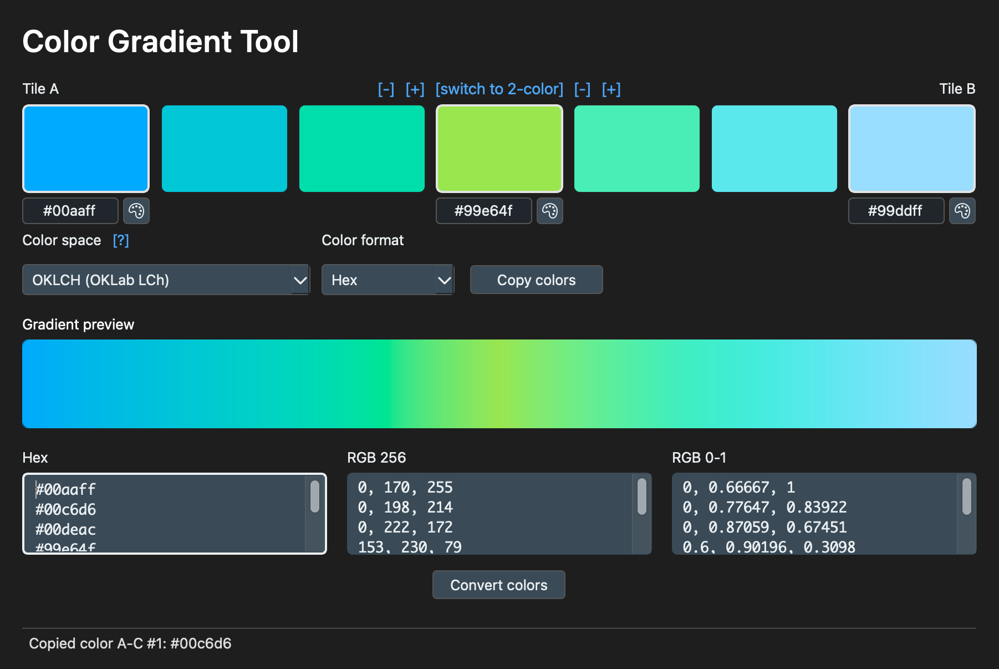

## Description

ColorGradientTool builds 2- or 3-point gradients in different color spaces
and lists the swatch colors in three boxes (Hex, RGB 256, RGB 0-1).

### Seed colors
- **A** (left, first), **B** (right, last) and **C** (center, only in 3-color mode).
- Type a hex value (`#rrggbb`, `rrggbb` or `#rgb`) in the box under each tile. A bad value turns the box red and the status bar says why.
- Click the palette icon next to the hex box to use the system color picker.
- Click a seed tile to copy its color (in the selected format); the status bar confirms.

### Gradients
- Color models: OKLCH, OKLab, LCH, Lab, HSL, HWB, sRGB (gamma) and sRGB (linear light).
- Hue-based models take the shortest path around the hue wheel.
- First and last swatches are exactly your seed colors.
- Out-of-gamut results are fitted back into sRGB.
- If something fails, the status bar shows the error. There are no silent fallbacks.

### Swatch boxes and converter
- The three boxes list the colors of the gradient swatches in each format; Copy uses the same lines.
- You can also paste a list of colors into any box to convert between Hex, RGB 0-1 and RGB 256 (see `COLOR_INPUT_ADAPTER_DOCS.md`). Parsing is strict: one bad line rejects the input and leaves your text alone.

## Running from source

```bash
pip install -r requirements.txt
python main.py
python -m unittest discover -s tests -t .   # tests
```

See `BUILD.md` for building the app.

Many thanks to the developers of
- coloraide
- PySide6
- pyinstaller
- the [codicon](https://github.com/microsoft/vscode-codicons) icon set by Microsoft (the palette icon, CC-BY 4.0)

And a tip of the hat to Copilot and its cousins—couldn’t have done it without you.
